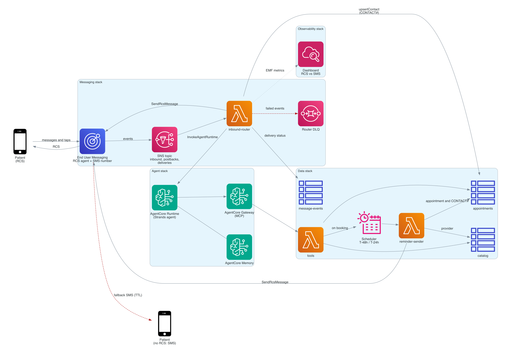
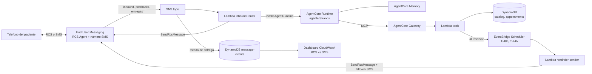

# ADR 001: arquitectura del concierge RCS (Aurora)

- Estado: **Aceptado (21/10/2026)**, aprobado por Agustín
- Fecha: 21/10/2026
- Base: [one pager aprobado](../one-pager.md)
- Copia en el repo del ADR original del equipo (21/10/2026).

## Decisión, en corto

Serverless, en una sola cuenta dev de DinoCloud y con CDK en TypeScript:

1. End User Messaging RCS para enviar y recibir, con fallback a SMS por mensaje.
2. SNS para los eventos de entrada.
3. Una Lambda que rutea al agente.
4. El agente en AgentCore Runtime, con Memory y Gateway.
5. Las tools en una Lambda sobre DynamoDB con datos sintéticos.
6. EventBridge Scheduler para los recordatorios.

No hay contenedores ni servidores propios, y Connect no se usa.

## Contexto

- **Qué pide el hackathon:** caso real de cliente, al menos un servicio de CDS, desplegado en AWS con AgentCore recomendado, proyecto nuevo con datos sintéticos y entrega el mié 28/10 a las 17:00 ART. La ejecución técnica vale 40 de 100 (deck del hackathon).
- **Alcance aprobado:** caso 1, concierge de turnos con carrusel y reserva, y caso 2, recordatorios a 48 h y 24 h con caída a SMS.
- **Equipo:** 3 personas con horas parciales y 6 días hábiles. Cada uno tiene que poder avanzar sin esperar al otro.
- **El marketplace** no tiene API de booking: todo el dominio se simula.

## Diagrama

Se regenera con `uv run --with diagrams python docs/diagrams/architecture.py` (requiere graphviz).

## Componentes

| Componente | Servicio | Responsabilidad | Owner |
| --- | --- | --- | --- |
| Canal | End User Messaging SMS v2: RCS Agent, número SMS, configuration set | Envío con `SendRcsMessage` (rich card, carrusel, respuestas sugeridas) y `FallbackConfiguration` a SMS con TTL. El agente RCS se registra a mano o por CLI; CDK solo lo referencia por ID | Leo |
| Entrada | SNS + Lambda `inbound-router` | Normaliza texto, postbacks y estados de entrega; deriva el session id del hash del teléfono; invoca al agente y responde por RCS | Leo |
| Agente | AgentCore Runtime (Python, Strands) + Memory | Conversación con el tono de la marca, sin consejo clínico, PII redactada antes de Memory | Agustín |
| Tools | AgentCore Gateway + Lambda `tools` | `search_providers`, `get_availability`, `book_appointment`, `reschedule_appointment`, `cancel_appointment` | Pablo |
| Datos | DynamoDB: `catalog`, `appointments`, `message-events` | Providers y slots sintéticos, turnos, historial de entregas | Pablo |
| Recordatorios | EventBridge Scheduler + Lambda `reminder-sender` | Schedules one-time a T-48h y T-24h, creados al reservar y borrados al cancelar; `DEMO_MODE` los comprime a minutos | Pablo |
| Observabilidad | CloudWatch dashboard + logs | Entregas por RCS contra fallback a SMS, errores, latencia del agente | Pablo |
| IaC | AWS CDK v2 en TypeScript, 4 stacks (Data, Agent, Messaging, Observability) | Deploy de un comando, sin desplegar hasta tener OK | Agustín (bin), cada owner su stack |

## Alternativas descartadas

| Alternativa | Por qué no |
| --- | --- |
| Amazon Connect como orquestador | Las reglas piden servicios nativos de CDS; además RCS no está integrado a Connect |
| Agente en Lambda con Bedrock directo, sin AgentCore | Más simple, pero pierde el componente recomendado por el hackathon y los puntos de ejecución técnica |
| ECS o Fargate para el agente | Más infraestructura y más tiempo; Runtime ya resuelve sesión y escalado |
| Cron o polling para recordatorios | Más código y menos preciso; Scheduler da un schedule por turno y se borra al cancelar |
| Tools dentro del agente, sin Gateway | Una pieza menos, pero acopla el trabajo de Pablo al de Agustín. Gateway separa las verticales y muestra más AgentCore |
| Terraform | Válido, pero CDK en TypeScript comparte lenguaje con las Lambdas y es lo que ya usamos en Velox |
| Firehose como event destination | SNS alcanza para el volumen de la demo y permite suscribir la Lambda directo |

## Consecuencias

- **A favor:** todo es serverless y se paga por uso. Cada persona tiene su carpeta y su stack, y el contrato entre piezas está escrito (eventos de SNS y tools del Gateway).
- **A favor:** el fallback a SMS es configuración por mensaje, no código propio. Se muestra en el dashboard.
- **En contra:** hay que mantener dos lenguajes, Python en el agente y TypeScript en las Lambdas y la IaC.
- **En contra:** AgentCore Runtime tiene un cold start de 5 a 8 s por sesión nueva. Para el video hay que precalentar la sesión.
- **Riesgo:** el soporte de AgentCore y de SMSVOICE en CloudFormation puede estar incompleto. Lo que falte va por script y queda documentado.
- **Riesgo:** el texto del paciente se trata como sensible aunque sea sintético. No se loguean mensajes completos y la PII se redacta antes de Memory.

## Plan B: SMS

- **Disparador:** si el jueves 22/10 el RCS Agent no está en estado Active o los teléfonos de prueba no reciben RCS.
- **Qué cambia:** el router y el reminder-sender usan `SendTextMessage`, el carrusel pasa a una lista numerada y los botones a respuestas "1, 2, 3". El agente, las tools, los datos y el Scheduler no cambian.
- **Qué se cuenta en la demo:** la lógica de fallback ya está, y RCS se activa con un flag cuando el agente quede aprobado. Mientras tanto se pide ayuda en el workshop o a los contactos de AWS CDS por medio de Lucas.
- **Costo del cambio:** un flag `CHANNEL_MODE=rcs|sms` en la config y un builder de payload por canal en `rcs-templates`.

## Criterio de aceptación

- `cdk synth` limpio para los 4 stacks.
- En el checkpoint del viernes 23/10: caso 1 de punta a punta en un teléfono real y un recordatorio que cae a SMS en un segundo teléfono.

## Referencias

- [RCS rich messaging](https://docs.aws.amazon.com/sms-voice/latest/userguide/rcs-rich-messaging.html)
- [Fallback por mensaje](https://docs.aws.amazon.com/sms-voice/latest/userguide/rcs-fallback-per-message.html)
- [Sample de AWS](https://github.com/aws-samples/sample-rcs-agent-setup-and-send-messages)
- [Anuncio de RCS con rich media](https://aws.amazon.com/about-aws/whats-new/2026/06/aws-end-user-messaging-rcs/)
